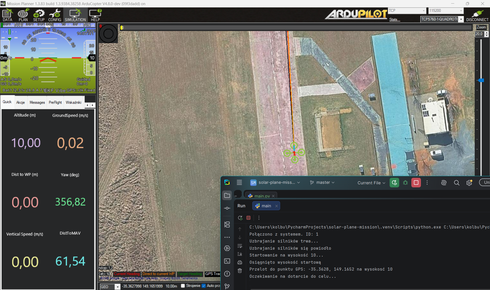

# AGH Solar Plane - Zadanie Rekrutacyjne

Autonomiczny skrypt sterujący dronem, przygotowany w ramach rekrutacji do AGH Solar Plane. Projekt realizuje pełną misję autonomiczną przy użyciu biblioteki `pymavlink` oraz środowiska symulacyjnego ArduCopter SITL i Mission Plannera.

## Opis działania
1. **Start:** Przejście w tryb `GUIDED`, uzbrojenie silników i start na wysokość 10 metrów.
2. **Nawigacja i dynamika:** Lot do wyznaczonego punktu GPS. W trakcie zbliżania się do celu skrypt dynamicznie przelicza odległość w metrach i redukuje prędkość przelotową.
3. **Zadanie badawcze:** Symulacja pracy czujnika (np. kamery/LiDARu) połączona z 5-sekundowym zawisem nad strefą docelową.
4. **Powrót (RTL):** Aktywacja procedury powrotu do bazy z asynchronicznym monitorowaniem stanu silników aż do całkowitego lądowania i rozbrojenia.

## Wymagania i technologie
* Python 3.10+
* `pymavlink`
* ArduCopter SITL / Mission Planner

## Struktura repozytorium
* `mission.py` – główny skrypt logiczny misji,
* `requirements.txt` – lista zależności projektu,
* `.gitignore` – konfiguracja ignorowanych plików lokalnych.

## Uruchomienie
1. Uruchom symulację ArduCopter SITL (np. w Mission Plannerze).
2. Sprawdź i w razie potrzeby dostosuj port połączeniowy w kodzie (np. TCP `5762`).
3. Uruchom skrypt w terminalu:
   ```bash
   python mission.py
   
## Podgląd działania
